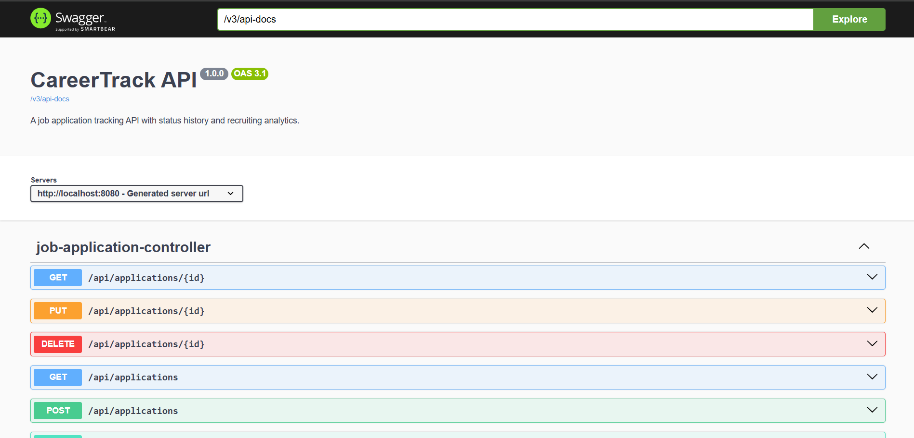
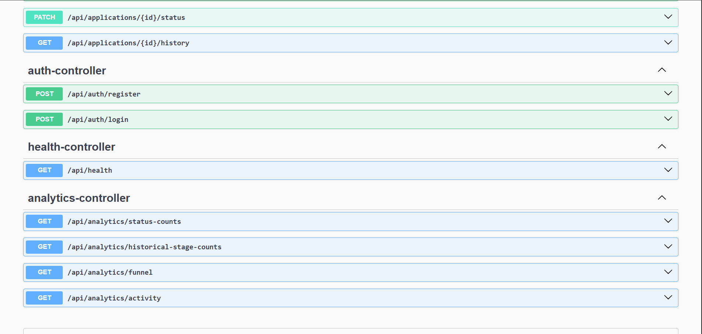
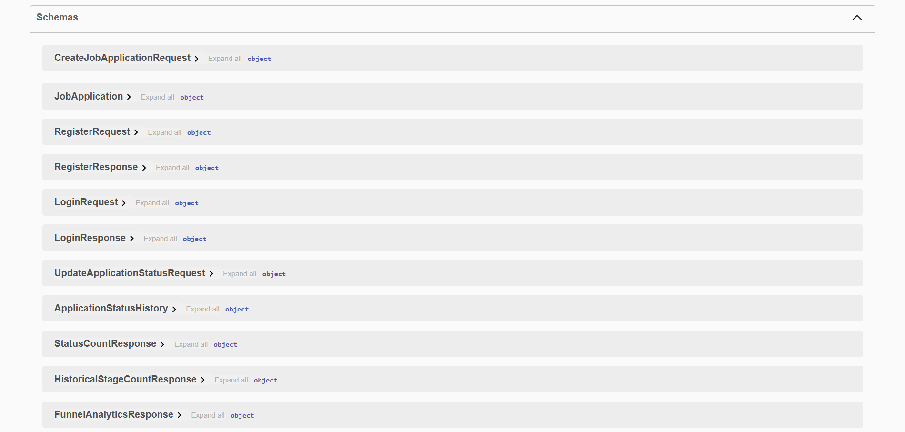

# CareerTrack API

A REST API for tracking job applications, recording status history, and analyzing a user's job-search pipeline. Built with Java 21, Spring Boot, Spring Security, PostgreSQL, Flyway, and Docker Compose.

**Repository:** https://github.com/lail0236/careertrack-api

## Features
- User registration and login with JWT access tokens.
- Password hashing with BCrypt.
- Authenticated, user-scoped application management.
- Create, retrieve, update, and delete job applications.
- Status tracking: `SAVED`, `APPLIED`, `ASSESSMENT`, `INTERVIEW`, `OFFER`, and `REJECTED`.
- Application status history.
- Per-user status, funnel, activity, and historical analytics.
- Request validation and centralized error handling.
- PostgreSQL migrations managed by Flyway.
- OpenAPI 3.1 documentation and Swagger UI.
- Docker Compose development environment.
- Automated tests and CI workflow.

## Technology stack

| Area | Technology |
|---|---|
| Language | Java 21 |
| Backend | Spring Boot |
| Security | Spring Security, JWT, BCrypt |
| Database | PostgreSQL |
| Migrations | Flyway |
| API documentation | OpenAPI 3.1 / Swagger UI |
| Containers | Docker, Docker Compose |
| Build and tests | Maven Wrapper |

## Architecture

```text
Client
  | HTTP + JSON; JWT bearer token for protected routes
  v
Spring Boot REST API
  |-- Authentication and authorization
  |-- Application management
  |-- Status history
  |-- Analytics
  v
PostgreSQL
  ^ Flyway-managed schema migrations
```

Protected application, history, and analytics operations are scoped to the authenticated user's identity.

## Prerequisites
- Git
- Docker Desktop with Docker Compose
- Java 21 for local development (the container workflow builds and runs the API in Docker)

## Run locally with Docker Compose

1. Clone the repository:

   ```powershell
   git clone https://github.com/lail0236/careertrack-api.git
   cd careertrack-api
   ```

2. Create the local environment file:

   ```powershell
   Copy-Item .env.example .env
   ```

3. Replace placeholders in `.env` with local values. Use a strong database password and a JWT secret of at least 32 bytes. Never commit `.env`.

4. Build and start:

   ```powershell
   docker compose up --build -d
   ```

5. Check services and API health:

   ```powershell
   docker compose ps
   Invoke-RestMethod http://localhost:8080/api/health
   ```

6. Open Swagger UI: http://localhost:8080/swagger-ui/index.html

   OpenAPI JSON: http://localhost:8080/v3/api-docs

### Stop services

```powershell
docker compose down
```

This preserves the named PostgreSQL volume. `docker compose down -v` deletes local database data; use it only when you intentionally want a clean database.

## Configuration

The Compose setup reads local secrets from `.env`. Start with `.env.example` and check the actual Compose configuration if variable names change. Never use example credentials or development secrets in a public deployment. Keep `.env` out of version control.

## API overview

The running OpenAPI document exposes **14 operations across four controller groups**. Local base URL: `http://localhost:8080`.

| Method | Endpoint | Purpose | Authentication |
|---|---|---|---|
| `GET` | `/api/health` | Health check | Public |
| `POST` | `/api/auth/register` | Register a user | Public |
| `POST` | `/api/auth/login` | Log in and receive a JWT | Public |
| `GET` | `/api/applications` | List the current user's applications | Required |
| `POST` | `/api/applications` | Create an application | Required |
| `GET` | `/api/applications/{id}` | Get one application | Required |
| `PUT` | `/api/applications/{id}` | Update an application | Required |
| `DELETE` | `/api/applications/{id}` | Delete an application | Required |
| `PATCH` | `/api/applications/{id}/status` | Change application status | Required |
| `GET` | `/api/applications/{id}/history` | Read status history | Required |
| `GET` | `/api/analytics/status-counts` | Current status counts | Required |
| `GET` | `/api/analytics/historical-stage-counts` | Historical stage counts | Required |
| `GET` | `/api/analytics/funnel` | Application funnel metrics | Required |
| `GET` | `/api/analytics/activity` | Application activity | Required |

For exact request examples and field constraints, see [`docs/API_EXAMPLES.md`](docs/API_EXAMPLES.md). Swagger UI exposes the live schemas.

## Authentication flow
1. Register through `POST /api/auth/register`.
2. Log in through `POST /api/auth/login`.
3. Copy the returned `accessToken`.
4. Send it on protected requests using `Authorization: Bearer YOUR_ACCESS_TOKEN`.

Access tokens are short-lived. Log in again when a token expires.

## Testing

```powershell
.\mvnw.cmd -B test
.\mvnw.cmd -B package
```

Docker smoke test:

```powershell
docker compose up --build -d
Invoke-RestMethod http://localhost:8080/api/health
```

Manual checks have verified that unauthenticated protected requests return HTTP 401, attempts to retrieve another user's application or history return HTTP 404, and analytics exclude another user's data.

## Security notes
- Passwords are stored as BCrypt hashes, not plaintext.
- Protected endpoints require JWT authentication.
- Application queries and analytics are scoped to the authenticated user.
- Keep `.env` and real credentials out of Git.
- Rotate any credential that was ever exposed in a public commit or log.
- Before public deployment, configure production-grade secrets, HTTPS, database access restrictions, backups, and logging.

## Swagger UI screenshots

### API overview


### Authentication and analytics


### Application endpoints and schemas


Do not include tokens, passwords, personal data, or `.env` contents.

## Project status

The core API, JWT authentication, per-user data isolation, analytics, database migrations, Docker workflow, automated tests, and API documentation have been implemented. The project is undergoing final portfolio presentation and deployment-readiness review.

## License

No license is specified. Add one explicitly if you want others to reuse the code.
